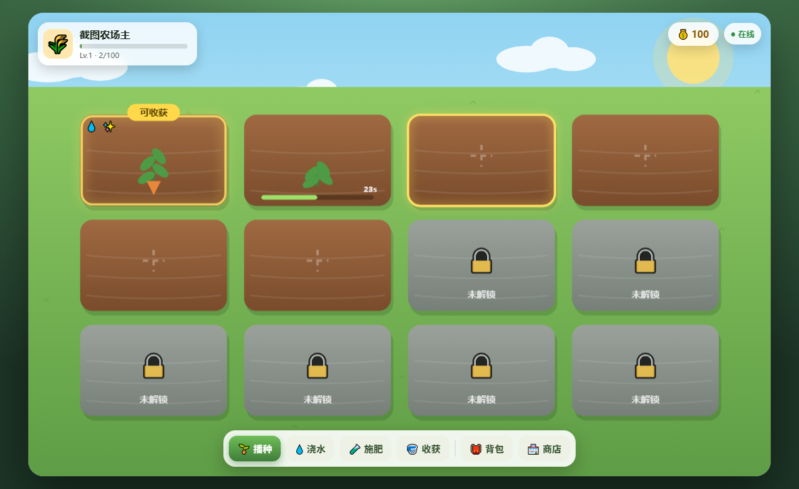

# MoonFarm

基于 [moon](https://github.com/sniper00/moon) 的类 QQ 农场游戏（学习/毕业设计项目）。



- 服务端：Lua + Actor 模型（gate / auth / user 三层，One Player One Service）
- 客户端：纯 HTML5 Canvas + WebSocket + protobufjs，无需安装任何引擎
- 存档：Redis（JSON）
- 玩法结构参考经典的 QQ 农场类游戏，代码、美术、数值均为原创

设计细节见 [`docs/design.md`](docs/design.md)。

## 环境要求

- moon 运行时（`bin/moon.exe`；Linux/macOS 为 `bin/moon`，需自行构建，见下）
- moon 的 Lua 库已随仓库放在 `server/lualib` 与 `server/service`，无需额外下载
- Redis 4.0+（本机 127.0.0.1:6379 即可）
- Node.js 14+（静态服务器与自动化测试用）
- 浏览器：任意支持 WebSocket 的现代浏览器

### 目录布局

本仓库是自包含的：moon 的 Lua 库已经拷贝到 `server/lualib`、`server/service`，
moon 可执行文件放在 `bin/`。部署时整个 `myFarm/` 目录即可独立运行，不再依赖 moon 源码目录：

```
myFarm/                    # 本仓库
├── bin/
│   └── moon.exe           # moon 运行时(Windows; Linux/macOS 为 bin/moon)
├── server/
│   ├── main.lua
│   ├── lualib/            # moon 框架 Lua 库(从 moon 仓库拷贝)
│   ├── service/           # moon 内置服务(redisd.lua 等)
│   ├── common/ game/ protocol/
│   └── serverconf.lua
├── client/
└── tools/
```

`lualib/` 与 `service/` 是 moon 框架的副本，升级 moon 时需要手动重新拷贝。

moon 本体需自行构建，构建后把可执行文件放进 `myFarm/bin/`：

```shell
git clone https://github.com/sniper00/moon
cd moon
premake5 build --release          # Windows 需 VS2022

# Windows
cp target/release/moon.exe <path>/myFarm/bin/moon.exe
# Linux / macOS
cp target/release/moon <path>/myFarm/bin/moon
```

## 运行

### 1. 启动服务端

默认连接本机 Redis（`127.0.0.1:6379`，无密码）。如需修改，可配置
`server/serverconf.local.lua`（本机私有文件，已加入 `.gitignore`）：

```lua
-- server/serverconf.local.lua
return {
    host = "0.0.0.0",
    port = 9001,
    redis = { host = "127.0.0.1", port = 6379, auth = nil },
}
```

也可以用环境变量覆盖（优先级最高）：

```shell
FARM_REDIS_HOST=127.0.0.1 FARM_REDIS_PORT=6379 FARM_REDIS_AUTH= ./server/start.bat
```

```shell
# 或在 Git Bash 中
cd myFarm/server
../bin/moon.exe main.lua          # Linux/macOS: ../bin/moon main.lua
```

启动后：

- TCP：`127.0.0.1:9001`
- WebSocket：`ws://127.0.0.1:9002/`

### 2. 打开客户端

```shell
node tools/serve.js 8080
# 浏览器打开 http://127.0.0.1:8080/
```

登录框里填任意 openid（同一 openid 会恢复同一份存档）和昵称。

### 3. 自动化验证

服务端启动后（另开终端）：

```shell
cd myFarm
node tools/test_e2e.js                 # 端到端: 登录/播种/浇水/施肥/成熟/收获/买卖/一键种植/一键收获/错误码
node tools/test_persist.js             # 断线重连后存档恢复
node tools/test_login_concurrency.js   # 登录/顶号并发: 双开、重复登录、登录中断开
```

文档截图（需要 Chrome）：

```shell
node tools/screenshot.js "http://127.0.0.1:8080/?auto=1&openid=demo&name=小农夫" docs/screenshot.png 8000
```

## 玩法（第一期竖切）

- 12 块地，初始解锁 6 块
- 4 种作物：胡萝卜(20s) / 小麦(45s) / 番茄(90s) / 草莓(150s)
- 播种 → 浇水(-10% 时间) → 施肥(-30% 时间，消耗化肥) → 成熟收获
- 收获获得果实 + 经验；商店买种子/化肥，卖果实换金币
- 点成熟地块直接收获；点空地弹底部种植条，可勾选“一键种植”批量种满空地
- 工具栏支持一键收获所有成熟地块
- 升级曲线：`100 + (等级-1)*50` 经验
- 数据每 5 秒自动存 Redis，下线/关服也会落盘

## 目录

```
myFarm/
├── server/                  # 服务端
│   ├── main.lua             # 入口: 加载 proto, 创建 db/auth/gate 服务
│   ├── serverconf.lua       # 端口/Redis 配置
│   ├── common/              # 框架公共层
│   │   ├── setup.lua        # 脚本自动加载 + C2S 分发 + 服务间封装
│   │   ├── protocol_pb.lua  # 协议编解码
│   │   ├── CmdCode.lua      # 消息码
│   │   ├── GameCfg.lua      # 静态配置加载
│   │   ├── Database.lua     # Redis 存档
│   │   └── config/          # crops / items / constants
│   ├── protocol/            # .proto 定义
│   └── game/
│       ├── service_gate.lua + gate/Gate.lua
│       ├── service_auth.lua + auth/Auth.lua
│       └── service_user.lua + user/{User,UserModel,Farm,Item,Shop}.lua
├── client/                  # HTML5 客户端
│   ├── index.html
│   ├── js/{net,protocol,cfg,game,main}.js
│   └── js/vendor/           # protobufjs + long.js
├── tools/                   # 静态服务器 / proto 内嵌 / e2e 测试
└── docs/                    # 设计文档与截图
```

## 改协议流程

1. 修改 `server/protocol/*.proto`
2. 在 `server/common/CmdCode.lua` 和 `client/js/protocol.js` 的 `CmdCode` 表里同步新增消息码
3. `node tools/gen_proto_inline.js` 重新生成 `client/js/proto-inline.js`
4. 重启服务端

## 说明

本项目的美术、代码、数值均为原创实现，不包含任何第三方游戏的代码或美术资源。

## 第三方组件

- [protobuf.js](https://github.com/protobufjs/protobuf.js) — BSD-3-Clause（`client/js/vendor/protobuf.min.js`）
- [long.js](https://github.com/dcodeIO/long.js) — Apache-2.0（`client/js/vendor/long.min.js`）
- [moon](https://github.com/sniper00/moon) — MIT（运行时框架，不在本仓库内）

## License

[MIT](LICENSE)
